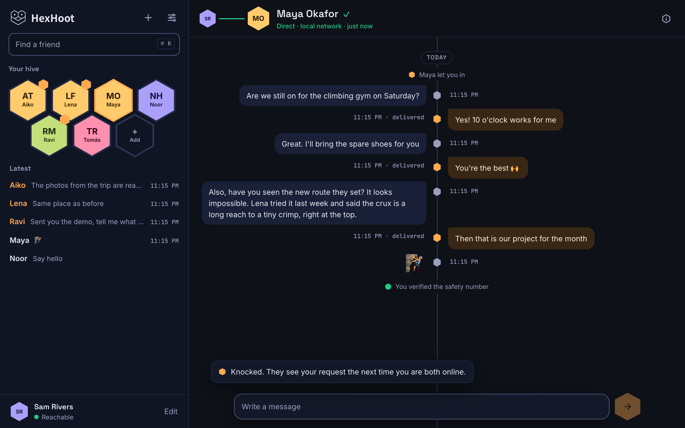
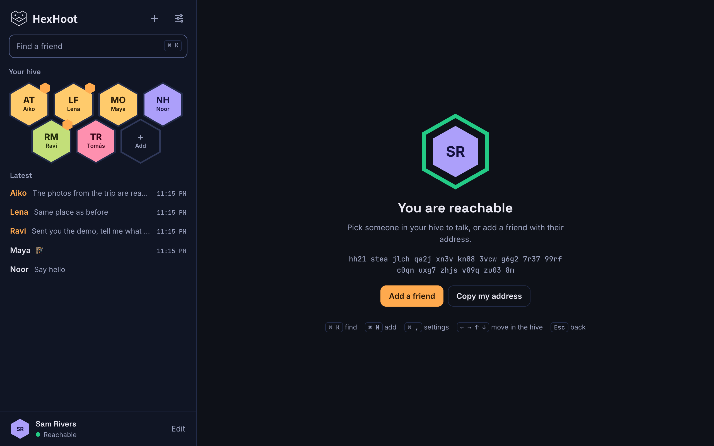
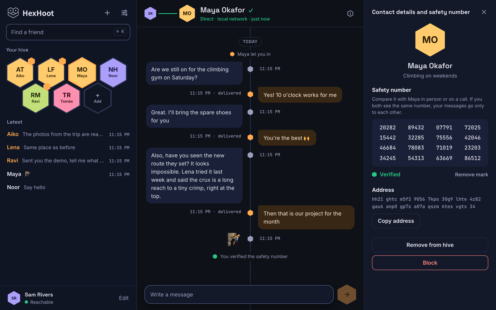
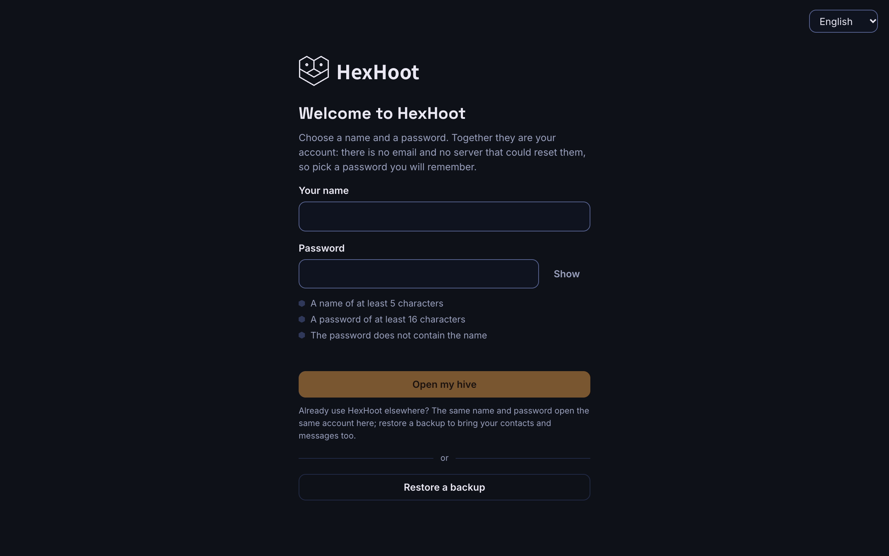

# HexHoot
<p align="center">
    <a href="//hexhoot.com">
        <picture>
            <source media="(prefers-color-scheme: light)" srcset="./modules/ImagePack/images/icon_lightmode.svg">
            
        </picture>
    </a>
</p>

HexHoot is an open-source, peer-to-peer messenger with no central servers. Your account is a key pair that is derived on your own computer from your name and password. Contacts find each other over a distributed hash table (DHT) on the internet, or directly on the local network. Messages are end-to-end encrypted with post-quantum hybrid cryptography.

> **Status: HexHoot 2.0 is in development and has not been independently reviewed yet.** Please don't rely on it for sensitive conversations until the external cryptographic review is done ([SECURITY.md](SECURITY.md)). The installers on the [releases page](https://github.com/zenineasa/HexHoot/releases/latest) are version 1, which cannot talk to version 2.

## Screenshots

<p align="center">
    <picture>
        <source media="(prefers-color-scheme: light)" srcset="./docs/screenshots/chat-day.png">
        
    </picture>
</p>

| Your hive | Safety number | Getting started |
|---|---|---|
|  |  |  |

The people and messages are made up; `node scripts/screenshots.mjs` recreates these screenshots with seven copies of the app on one computer.

## Why HexHoot?

The following question is something that people would ask me quite often when I talk to them about HexHoot. If you look around, you can see quite a lot of software, like WhatsApp, Slack, Microsoft Teams, Zoom, etc., that helps in communication. Why would one attempt to create yet another tool that solves the same problem?

The thing is, we are not exactly trying to compete with the existing communication platforms head-on; rather, we are setting up a framework that would enable the concept of user authentication in applications that can run without any centralized servers.

Much of the traditional software that enabled peer-to-peer communication relied on a centralized server to authenticate users, not because they wanted to do this, but because that was probably the only way at the time. HexHoot does without one. Your identity is a key pair that only your name and password can recreate, your address is a fingerprint of it, and every conversation starts with a handshake in which both sides prove they hold their keys. Nobody needs to vouch for anyone.

Internet is supposed to be free; free as in "libre" and not "gratis". There is a tendency in the world that certain closed source algorithms are actively deciding what content the people must be exposed to. You can't view their source code, while they read each and everything about you.

We would like to reverse that. HexHoot is an Open Source project that is aimed at creating a platform for communication between people, while all data is stored locally on the users' computers.

## How it works

- **Your account is your name and password.** Signing in for the first time derives your keys from them, which takes a few seconds on purpose: it makes guessing passwords very slow. The password needs at least 16 characters. After that, your operating system's keychain keeps you signed in, and now and then HexHoot offers a quick, optional check that you still remember your password. There is no server, so a forgotten password cannot be recovered.
- **Your address** starts with `hh21` and is 62 characters long. Share it with friends. A friend request waits until the other person accepts it, and nothing about you is sent until they do.
- **Safety numbers.** Each contact's profile shows an 80-digit number. If you and your friend see the same number, for example when you compare it in person or on a call, your messages go only to each other.
- **Two ways to connect.** Over the internet through Hyperswarm's DHT, and on the local network directly. Both carry only encrypted data.
- **Messages wait until they are delivered.** If your friend is offline, messages stay on your computer and go out when they come back online. There is no server that holds them in the meantime, so both of you need to be online at the same time at some point.
- **Backups.** You can save your contacts and chat history as an encrypted `.hexhoot2` file, protected by a passphrase you choose.

## Security in brief

| What | How |
|---|---|
| Key exchange | ECDH P-521 together with ML-KEM-1024 (post-quantum): a message stays secret as long as either one holds |
| Signatures | ECDSA P-521 together with ML-DSA-87, and both must verify |
| Sessions | A SIGMA-I handshake, then a Double Ratchet with a fresh ML-KEM-1024 exchange in every turn, for forward secrecy and recovery after a compromise |
| Encryption | AES-256-GCM, with a new key for every message |
| On your computer | Everything is encrypted under a key that the operating system's keychain protects |
| Libraries | Only the cryptography built into Electron; no third-party crypto library |

The [design documents](docs/index.md) describe all of it in detail, and [SECURITY.md](SECURITY.md) covers what HexHoot does *not* protect against and how to report a problem.

## Try the development version

1. Install [Node.js](https://nodejs.org/) 22.13 or later.
2. Clone this repository and install the packages:
   ```
   npm ci
   ```
3. Start HexHoot:
   ```
   npm start
   ```

To run the tests (unit, crypto, protocol, Core, and end-to-end tests that launch several copies of the app and have them talk to each other):
```
npm test
```

## Documentation

The [docs](docs/index.md) folder holds the assessment of version 1, the design of version 2, the decisions behind it, and the roadmap.

## Read our blog

Blog posts detailing the technical aspects and broader vision are published on our blog.
https://blog.hexhoot.com/

##

Copyright &copy; 2022-2026 Zenin Easa Panthakkalakath
